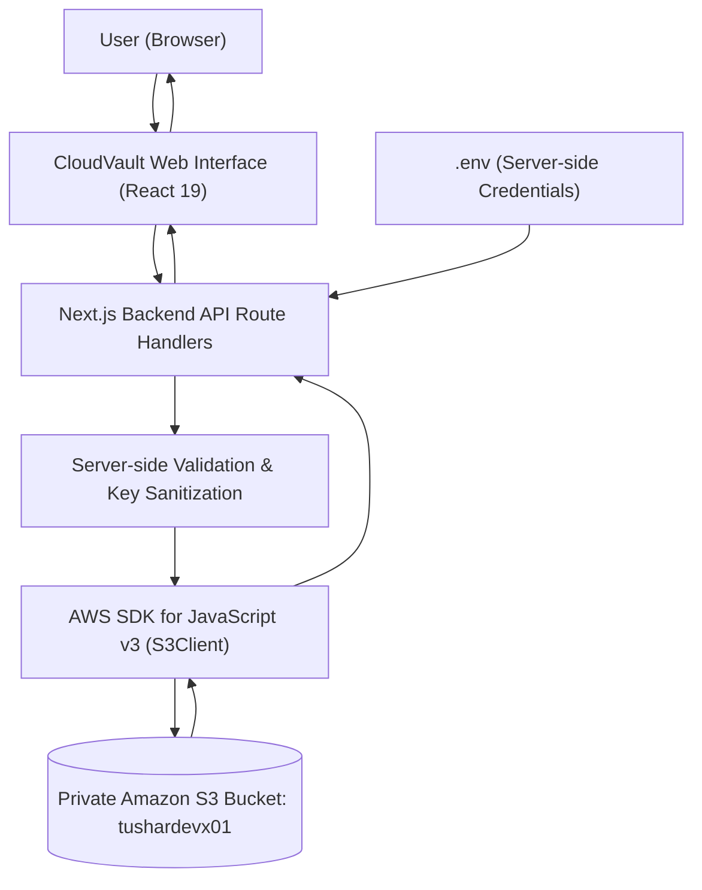
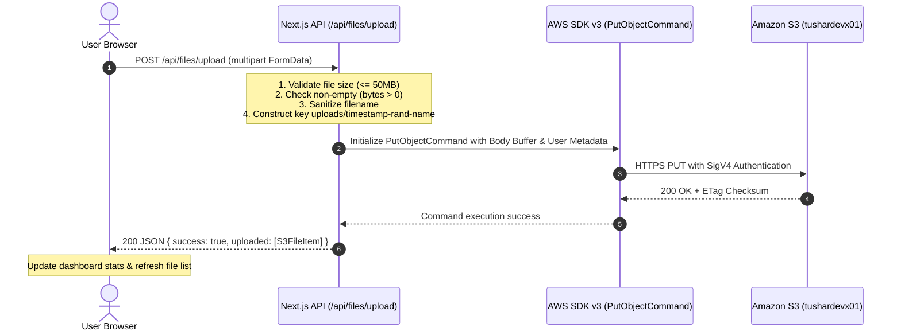
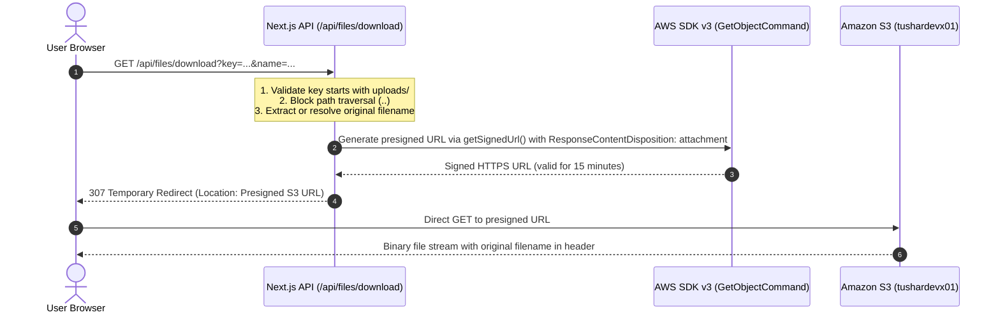
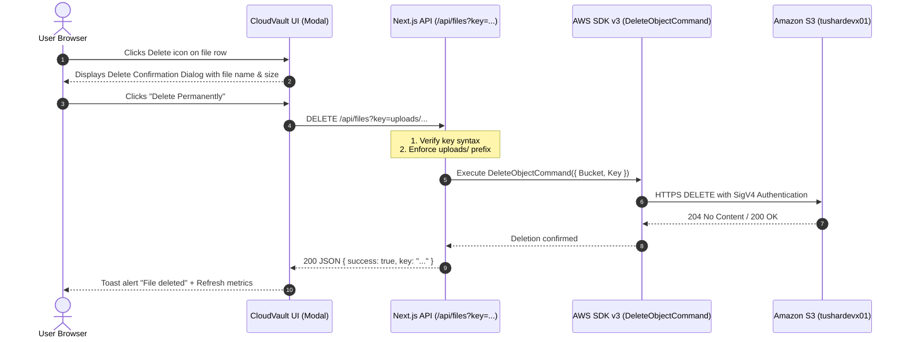

# CloudVault — System Architecture & Technical Specifications

> **Academic Cloud Computing Project (25 Marks)**  
> **Target Cloud Provider**: Amazon Web Services (AWS) — Simple Storage Service (S3)  
> **Bucket Name**: `tushardevx01`  
> **Region**: `ap-south-1` (with dynamic multi-region fallback to `ap-southeast-2`)  
> **Architecture Pattern**: Mediated 3-Tier Cloud Object Storage (`Browser → Next.js API → AWS SDK → Private Amazon S3`)

---

## 1. Project Overview

**CloudVault** is a minimal, cloud-based file storage and management web application designed as an academic Cloud Computing project worth 25 marks. 

In traditional computing environments, files reside on local block devices (Ext4, NTFS, APFS) bound to a single host operating system. CloudVault demonstrates how modern software decouples data persistence from application compute by leveraging **Amazon Simple Storage Service (Amazon S3)** as a durable, elastic, and globally accessible object store.

The project demonstrates complete file lifecycle management—uploading, listing, previewing, downloading, and deleting—while preserving filename integrity, enforcing strict server-side credential isolation, and maintaining zero permanent storage footprint on the application server.

---

## 2. Project Objectives

1. **Demonstrate Real Cloud Persistence**: Directly persist binary objects to an actual Amazon S3 private bucket rather than using local temporary directories or mocked in-memory arrays.
2. **Eliminate Compute-Storage Coupling**: Decouple the Next.js compute layer from the file persistence layer, allowing the application to be stopped, restarted, or cloned to another environment (such as an Ubuntu VirtualBox VM) without losing data.
3. **Preserve Filename Integrity Without Database Dependencies**: Use Amazon S3 User-Defined Metadata (`x-amz-meta-original-name`) and collision-resistant unique keys (`uploads/<timestamp>-<rand>-<sanitizedName>`) to store and retrieve files without an external SQL or NoSQL database.
4. **Secure Credential Isolation**: Restrict AWS access keys exclusively to server-side execution. Never expose credentials to browser bundles, network payloads, or client logs.
5. **Provide a Clean SaaS User Experience**: Deliver a responsive, minimal interface with clear loading states, progress feedback, preview support for images and PDFs, and confirmation modals for destructive operations.

---

## 3. Functional Requirements

| Identifier | Category | Requirement Description |
| :--- | :--- | :--- |
| **FR-01** | Upload | Allow users to select single or multiple files from local disk and upload them directly to Amazon S3. |
| **FR-02** | Validation | Validate file size on both client and server (enforce a 50MB ceiling) and reject empty (0-byte) files. |
| **FR-03** | Listing | Query S3 via `ListObjectsV2Command` and display objects with filename, size, MIME type, and upload date. |
| **FR-04** | Search & Filter | Provide real-time client-side substring search by name/key and filtering across categories (Images, Documents, Media, Archives, Code, Other). |
| **FR-05** | Sorting | Allow bidirectional sorting (ascending / descending) by upload date, original name, and file size. |
| **FR-06** | Preview | Generate secure, short-lived (15-minute) presigned URLs with `inline` disposition to preview JPG, PNG, WebP, SVG, and PDF files. |
| **FR-07** | Download | Stream or issue a 307 redirect to a presigned S3 URL with `attachment` disposition, ensuring the browser saves the original filename. |
| **FR-08** | Deletion | Prompt users with a confirmation modal before dispatching a `DeleteObjectCommand` to permanently remove an object from S3. |
| **FR-09** | Dashboard Metrics | Calculate total files, total storage consumed, category distribution percentages, and recent uploads dynamically from S3. |
| **FR-10** | Error Handling | Display clear, non-cryptic error notifications for missing credentials, network disconnects, or invalid operations. |

---

## 4. Technology Stack

| Layer | Technology | Version | Justification |
| :--- | :--- | :--- | :--- |
| **Frontend Framework** | Next.js (App Router) | 16.4+ | Server-side rendering, client state management, and unified routing. |
| **Language** | TypeScript | 5.0+ | Strict typing, robust interfaces, and elimination of `any` bugs. |
| **Styling** | Tailwind CSS | 4.0+ | Modern utility-first CSS, minimal palette, and responsive design tokens. |
| **Backend Runtime** | Next.js Route Handlers | Node.js 20+ | Standard Web API Request/Response handlers executing server-side only. |
| **Cloud Object Storage**| Amazon S3 | AWS v3 | Industry-standard cloud object store offering 99.999999999% (11 9's) durability. |
| **AWS SDK** | AWS SDK for JavaScript v3 | 3.700+ | Modular packages (`@aws-sdk/client-s3`, `@aws-sdk/s3-request-presigner`). |
| **Iconography** | Lucide React | Latest | Clean, consistent SVG icon set for file categories and user actions. |
| **Package Manager** | npm | 11.0+ | Standard package management across Linux distributions. |

---

## 5. System Architecture

CloudVault enforces a mediated 3-tier architecture where the client browser never directly interacts with Amazon S3 using long-lived credentials. All requests are authenticated, sanitized, and mediated through Next.js server-side route handlers.

```
┌─────────────────┐       HTTPS       ┌────────────────────────┐       AWS SDK v3       ┌──────────────────────┐
│  Client Browser │ ────────────────> │ Next.js Backend Engine │ ─────────────────────> │  Amazon Web Services │
│ (React / UI)    │ <──────────────── │ (App Route Handlers)   │ <───────────────────── │  (Amazon S3 Bucket)  │
└─────────────────┘      REST API     └────────────────────────┘      SigV4 / REST      └──────────────────────┘
                                                  │
                                                  ▼
                                      ┌────────────────────────┐
                                      │  Environment (.env)    │
                                      │  (Strictly Server-Side)│
                                      └────────────────────────┘
```

---

## 6. Mermaid System Architecture & Workflow Diagrams

### 6.1 Primary System Architecture Diagram



**Technical Explanation**:  
1. The user interacts with the CloudVault web interface in their browser.
2. The browser dispatches HTTP requests (multipart form data for uploads, GET for listing/preview, DELETE for removal) to Next.js API route handlers.
3. The server loads AWS credentials from `.env`, validates incoming payloads (checking sizes, MIME types, and path traversal tokens), and constructs sanitized S3 keys.
4. The AWS SDK for JavaScript v3 signs requests using AWS Signature Version 4 (SigV4) and dispatches them over HTTPS to the private Amazon S3 bucket.
5. S3 returns object data or status responses back through the backend to the UI.

---

### 6.2 File Upload Workflow Diagram



**Technical Explanation**:  
When a user selects files and clicks Upload, the browser streams a `multipart/form-data` request. Next.js converts the incoming stream into a memory buffer, checks that the file is not empty and under 50MB, generates a unique key prefixed with `uploads/`, and attaches the original filename in the `x-amz-meta-original-name` metadata header. The file is written directly to S3 via `PutObjectCommand`.

---

### 6.3 File Download Workflow Diagram



**Technical Explanation**:  
When the user clicks Download, the browser calls `/api/files/download`. Rather than piping megabytes of binary data through the server process, CloudVault generates a cryptographically signed Amazon S3 presigned URL with `ResponseContentDisposition` set to `attachment; filename="<original_name>"`. The server responds with an HTTP 307 redirect, causing the browser to fetch the file directly from S3 at full bandwidth while preserving the original filename.

---

### 6.4 File Deletion Workflow Diagram



**Technical Explanation**:  
To prevent accidental data loss, the user is prompted with an accessible confirmation dialog showing the file's name and size. Upon confirmation, a `DELETE` request is sent to `/api/files`. The backend verifies the key against directory traversal, issues `DeleteObjectCommand` to S3, and notifies the client to refresh the file table and storage metrics immediately.

---

## 7. Application Folder Structure

```
CloudVault/
├── .env                         # Single environment configuration file (STRICT: gitignored)
├── .gitignore                   # Excludes .env, node_modules, build outputs
├── AGENTS.md                    # Environment and tool instructions
├── ARCHITECTURE.md              # Detailed architecture & technical specification
├── README.md                    # Setup, VirtualBox guide, and academic defense
├── next.config.ts               # Next.js build configuration
├── package.json                 # Project dependencies and npm scripts
├── package-lock.json            # Lockfile ensuring deterministic installs
├── tsconfig.json                # TypeScript compiler configuration (strict: true)
├── public/                      # Static web assets
└── src/
    ├── app/
    │   ├── api/                 # Next.js Route Handlers (Backend API)
    │   │   ├── files/
    │   │   │   ├── route.ts     # GET (list/filter/sort), DELETE (remove from S3)
    │   │   │   ├── download/
    │   │   │   │   └── route.ts # GET (presigned URL download redirect)
    │   │   │   ├── preview/
    │   │   │   │   └── route.ts # GET (presigned inline preview URL)
    │   │   │   └── upload/
    │   │   │       └── route.ts # POST (multipart/form-data upload to S3)
    │   │   ├── health/
    │   │   │   └── route.ts     # GET (S3 connectivity verification)
    │   │   └── stats/
    │   │       └── route.ts     # GET (aggregate storage metrics from S3)
    │   ├── globals.css          # Tailwind CSS tokens, theme variables, and scrollbars
    │   ├── layout.tsx           # Root HTML structure with metadata
    │   └── page.tsx             # Main client dashboard application
    ├── components/              # Modular, reusable React UI components
    │   ├── CloudVsLocalSection.tsx  # Academic storage comparison & checklist
    │   ├── DeleteConfirmModal.tsx   # Deletion confirmation dialog
    │   ├── FileGrid.tsx             # Grid card view of files
    │   ├── FileIcon.tsx             # Category-specific Lucide icon mapper
    │   ├── FileList.tsx             # Table view of files with actions
    │   ├── FilePreviewModal.tsx     # Image/PDF lightbox viewer
    │   ├── Navbar.tsx               # Top search and status navigation bar
    │   ├── Sidebar.tsx              # Sidebar drawer with bucket stats
    │   ├── StatsCards.tsx           # High-level metric KPI cards
    │   ├── StorageBreakdown.tsx     # Visual category proportion bar
    │   ├── SystemHealthSection.tsx  # AWS S3 connectivity diagnostics
    │   ├── Toast.tsx                # Accessible floating notifications
    │   └── UploadModal.tsx          # Multi-file drag-and-drop uploader
    ├── lib/                     # Server-side utilities and AWS integration
    │   ├── s3.ts                # S3Client, commands, auto-region resolution
    │   └── utils.ts             # Bytes formatter, categories, key sanitization
    └── types/
        └── file.ts              # TypeScript interfaces and shared types
```

---

## 8. Frontend Architecture

### 8.1 Component Hierarchy
```
RootLayout (layout.tsx)
└── CloudVaultApp (page.tsx)
    ├── ToastContainer (Toast.tsx)
    ├── Sidebar (Sidebar.tsx)
    └── Main Content Area
        ├── Navbar (Navbar.tsx)
        ├── Tab: Dashboard
        │   ├── StatsCards (StatsCards.tsx)
        │   ├── StorageBreakdown (StorageBreakdown.tsx)
        │   └── Recent Uploads -> FileList (FileList.tsx)
        ├── Tab: All Files
        │   ├── Search & Filter Toolbar
        │   └── FileList (Table) OR FileGrid (Cards)
        ├── Tab: Cloud vs Local Storage (CloudVsLocalSection.tsx)
        ├── Tab: Bucket Health (SystemHealthSection.tsx)
        ├── UploadModal (UploadModal.tsx)
        ├── FilePreviewModal (FilePreviewModal.tsx)
        └── DeleteConfirmModal (DeleteConfirmModal.tsx)
```

### 8.2 State Management
The UI uses idiomatic React 19 hooks (`useState`, `useEffect`, `useCallback`, `useMemo`) without bloated external state libraries:
- `files`: In-memory list of S3 files populated via `/api/files`.
- `stats`: Storage metrics fetched from `/api/stats`.
- `searchTerm`, `categoryFilter`, `sortBy`, `sortOrder`: Reactive filter controls applied via memoized computation (`processedFiles`).
- `connectionStatus`: S3 health state (`connected` | `disconnected` | `checking`) providing instant diagnostic cues to the user.

---

## 9. Backend Architecture

CloudVault relies on Next.js App Router Route Handlers executing in a Node.js server runtime:
1. **Stateless Operations**: No persistent session state or file buffers remain on disk after a request terminates.
2. **Streaming Execution**: Memory buffers are allocated only during active file upload processing and promptly released.
3. **Decoupled API Contract**: All endpoints return standard JSON responses conforming to the `ApiResponse<T>` TypeScript interface:
   ```ts
   interface ApiResponse<T = unknown> {
     success: boolean;
     data?: T;
     error?: string;
     message?: string;
   }
   ```

---

## 10. AWS S3 Integration

The application integrates with AWS using modular packages from the official AWS SDK for JavaScript v3:
- `@aws-sdk/client-s3`: Provides `S3Client`, `HeadBucketCommand`, `PutObjectCommand`, `ListObjectsV2Command`, `GetObjectCommand`, `DeleteObjectCommand`, and `GetBucketLocationCommand`.
- `@aws-sdk/s3-request-presigner`: Provides `getSignedUrl` for generating cryptographically secure SigV4 pre-authenticated URLs.

### Dynamic Region Fallback Mechanism
While academic specifications frequently state `ap-south-1` (Mumbai), buckets may physically reside in other regions (e.g., `ap-southeast-2` Sydney). CloudVault incorporates automated regional discovery:
```ts
async function executeWithAutoRegion<T>(operation: (client: S3Client) => Promise<T>): Promise<T> {
  const client = getS3Client();
  try {
    return await operation(client);
  } catch (error: any) {
    if (error.name === "PermanentRedirect" || error.$metadata?.httpStatusCode === 301) {
      // Query global location constraint and transparently reconnect
      await autoResolveBucketRegion(getBucketName());
      return await operation(getS3Client());
    }
    throw error;
  }
}
```
This guarantees that regardless of minor regional discrepancies, the application self-heals and communicates with the real bucket without manual intervention.

---

## 11. API Endpoint Definitions

| Endpoint | Method | Input Parameters | Success Response | Error Response | Description |
| :--- | :--- | :--- | :--- | :--- | :--- |
| `/api/health` | `GET` | None | `200 OK`<br/>`{ success: true, connected: true, bucket: "...", region: "..." }` | `503 Service Unavailable`<br/>`{ success: false, connected: false, message: "..." }` | Checks S3 bucket accessibility via `HeadBucketCommand`. |
| `/api/stats` | `GET` | None | `200 OK`<br/>`{ success: true, stats: { totalFiles, totalSizeBytes, categories, recentUploads } }` | `500 Internal Error`<br/>`{ success: false, error: "..." }` | Computes storage breakdown by file category from S3. |
| `/api/files` | `GET` | Query: `search`, `category`, `sortBy`, `sortOrder` | `200 OK`<br/>`{ success: true, count: N, files: [...] }` | `500 Internal Error`<br/>`{ success: false, error: "..." }` | Lists all S3 objects under `uploads/` prefix. |
| `/api/files/upload` | `POST` | `FormData` with `files` (array of `File`) | `200 OK`<br/>`{ success: true, uploaded: [...] }` | `400 Bad Request`<br/>`{ success: false, error: "...", details: [...] }` | Uploads files to S3 with sanitized keys and metadata. |
| `/api/files/download`| `GET` | Query: `key`, `name` | `307 Temporary Redirect` to signed S3 URL | `400 Bad Request`<br/>`{ success: false, error: "Invalid key" }` | Generates a 15-minute download URL with attachment header. |
| `/api/files/preview` | `GET` | Query: `key`, `name` | `200 OK`<br/>`{ success: true, previewUrl: "https://...", category: "..." }` | `400 Bad Request`<br/>`{ success: false, error: "..." }` | Generates a 15-minute inline URL for images and PDFs. |
| `/api/files` | `DELETE`| Query: `key` | `200 OK`<br/>`{ success: true, message: "...", key: "..." }` | `400 / 500`<br/>`{ success: false, error: "..." }` | Permanently deletes an object from Amazon S3. |

---

## 12. File Operation Workflows

1. **Listing Workflow**: 
   - `GET /api/files` queries `ListObjectsV2Command({ Bucket, Prefix: "uploads/" })`.
   - Each item's key is parsed using regex to extract the original filename.
   - File category is derived from the filename extension.
   - Items are sorted by date descending by default.
2. **Preview Workflow**:
   - Supported formats: JPG, PNG, WebP, GIF, SVG, and PDF.
   - The UI requests `/api/files/preview?key=...`.
   - The server calls `getSignedUrl` with `ResponseContentDisposition: inline`.
   - The client renders images inside a responsive image container and PDFs inside an embedded iframe.
   - For unsupported formats (e.g., zip, mp4), the modal displays a dedicated format icon and provides a direct download button.

---

## 13. Security Architecture

1. **Complete Credential Isolation**: AWS credentials exist strictly within server memory and are never exposed in Next.js browser bundles, responses, or client DOM.
2. **Private Bucket Policy**: The bucket `tushardevx01` has "Block Public Access" enabled. No object is ever made publicly accessible.
3. **Time-Bounded Presigned URLs**: Pre-authenticated access tokens for download and preview expire automatically after 900 seconds (15 minutes).
4. **Path Traversal & Injection Defense**:
   - All object keys are required to start with `uploads/`.
   - Filenames are sanitized via regex `replace(/[^a-zA-Z0-9._-]/g, "_")`.
   - Any query containing `..` or illegal characters is rejected immediately with HTTP 400.
5. **Payload Restrictions**: Enforces a strict 50MB single-file size ceiling and rejects 0-byte files.

---

## 14. Environment Configuration

### Strict Single `.env` Rule
- Exactly **one** configuration file is used: `.env`.
- Never create `.env.example`, `.env.local`, `.env.production`, or other variants.
- `.env` is permanently excluded in `.gitignore` and must never be committed.

```env
AWS_REGION=ap-south-1
AWS_ACCESS_KEY_ID=your_access_key_here
AWS_SECRET_ACCESS_KEY=your_secret_key_here
AWS_S3_BUCKET_NAME=tushardevx01
```

---

## 15. Error-Handling Strategy

CloudVault classifies and handles errors gracefully across all layers:

1. **Missing or Incomplete `.env`**:
   - Returns a friendly banner in the UI: *"Amazon S3 Credentials Pending in .env"*.
   - Never exposes secret values; identifies missing variable names safely.
2. **AWS S3 Connectivity Failures**:
   - Maps raw AWS exceptions (`InvalidAccessKeyId`, `SignatureDoesNotMatch`, `AccessDenied`, `NotFound`) to human-readable explanations.
3. **Upload Failures**:
   - If individual files in a multi-file batch fail (e.g., file too large), the server returns partial results with a detailed error array, allowing successful files to persist.
4. **Network Dropouts**:
   - The client UI uses floating toast notifications with 5-second automatic dismissals to alert users without interrupting their workflow.

---

## 16. Fedora Development & Ubuntu VirtualBox Execution Workflow

### 16.1 Local Development (Fedora Workstation)
```bash
# Verify environment
node -v    # Expected v20+
npm -v     # Expected v10+

# Install and start
npm install
npm run dev
# Application available at http://localhost:3000
```

### 16.2 Cross-Environment Demonstration (Ubuntu VirtualBox)
To prove cloud decoupling during university evaluation:
1. **Network Setting**: Configure VirtualBox network adapter to **Bridged Adapter** (or NAT with Port Forwarding `3000 -> 3000`).
2. **Terminal in Ubuntu VM**:
   ```bash
   sudo apt update && sudo apt install -y nodejs npm git
   git clone https://github.com/tushardevx01/CloudVault.git
   cd CloudVault
   cat << 'EOF' > .env
   AWS_REGION=ap-south-1
   AWS_ACCESS_KEY_ID=your_access_key
   AWS_SECRET_ACCESS_KEY=your_secret_key
   AWS_S3_BUCKET_NAME=tushardevx01
   EOF
   npm install
   npm run dev
   ```
3. **Verification**: Open `http://localhost:3000` inside Ubuntu. The exact files uploaded from the host workstation appear immediately because both machines query the shared, decoupled Amazon S3 cloud bucket.

---

## 17. UI/UX Design System Specification

### 17.1 Color Tokens
- **Background Deep**: `#0b0f17` (rich slate-black, avoids harsh pure black).
- **Surface Layer 1**: `#0f172a` (sidebar and navbar background).
- **Surface Layer 2 (Cards & Tables)**: `#1e293b` with border `#334155`.
- **Text Primary**: `#f8fafc` (high-contrast white).
- **Text Secondary**: `#94a3b8` (muted slate for metadata).
- **Accent Primary (Cloud Sky)**: `#38bdf8` / hover `#0284c7`.
- **Success State**: `#34d399` (emerald).
- **Warning State**: `#fbbf24` (amber).
- **Error State**: `#f87171` (rose).

### 17.2 Typography & Spacing
- **Font Stack**: System sans-serif (`-apple-system, BlinkMacSystemFont, "Segoe UI", Roboto, Oxygen, Ubuntu, Cantarell, "Helvetica Neue", sans-serif`).
- **Hierarchy**:
  - Page Titles: `text-xl font-bold tracking-tight text-white`
  - Section Headings: `text-base font-semibold text-white`
  - Card Metrics: `text-2xl sm:text-3xl font-extrabold text-white font-mono`
  - Body / Table Rows: `text-xs text-slate-300`
  - Badges & Micro-copy: `text-[10px] sm:text-[11px] font-medium text-slate-400`
- **Spacing**: Consistent 4px grid (`p-3`, `p-4`, `p-6`, `gap-3`, `gap-4`, `gap-6`).
- **Border Radii**: Cards (`rounded-2xl`), Modals (`rounded-3xl`), Buttons & Inputs (`rounded-xl`), Badges (`rounded-lg` / `rounded-full`).
- **Transitions**: Restrained `duration-200 ease-in-out` for hover and focus states.
